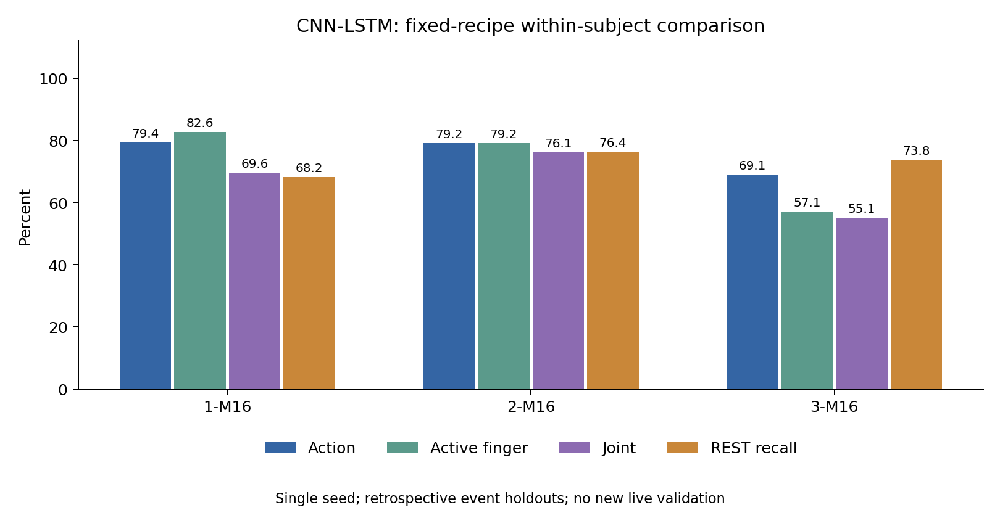

# CNN-LSTM comparison

Fixed 60-epoch recipe, seed 43, separate subject models, unsmoothed predictions with available calibration (identity where classes are missing).
Retrospective event holdouts; no unseen-session or live-actuation claim.

| Subject | Fit | Calibration | Test | Action | Active finger | Joint | REST recall | Event joint |
| --- | --- | --- | --- | --- | --- | --- | --- | --- |
| 1-M16 | 10803 | 1049 | 2815 | 79.36% | 82.61% | 69.59% | 68.20% | 75.83% |
| 2-M16 | 10647 | 1124 | 2837 | 79.20% | 79.16% | 76.07% | 76.35% | 85.71% |
| 3-M16 | 5708 | 621 | 1669 | 69.08% | 57.13% | 55.12% | 73.80% | 52.38% |

Finger accuracy conditions on true movement; predicted REST counts as an error.
Event joint uses the majority joint label within each held-out source event.

## Per-finger recall

| Subject | Thumb | Index | Middle | Ring | Pinky |
| --- | ---: | ---: | ---: | ---: | ---: |
| 1-M16 | 98.52% | 88.87% | 78.32% | 55.56% | 84.05% |
| 2-M16 | 94.99% | 75.80% | 72.35% | 76.02% | 74.16% |
| 3-M16 | 83.27% | 23.26% | 49.16% | 79.15% | 37.55% |

## Historical context

| Historical CNN-LSTM | Action | Active finger | Joint |
| --- | ---: | ---: | ---: |
| 1-M16 September initial 60 epochs | 76.23% | 81.75% | 67.71% |
| 2-M16 March deployment reference | 89.79% | 85.96% | 84.66% |
| 3-M16 September initial 60 epochs | 67.77% | 59.47% | 53.62% |

The 1-M16/3-M16 datasets and outer test indices match the September initial comparison,
but fitting/calibration allocation and normalizer fitting changed. The 2-M16 November
dataset includes April and uses a different test set. These are not controlled architecture deltas.
Historical values are archived summaries; November values are recomputed from saved predictions.

